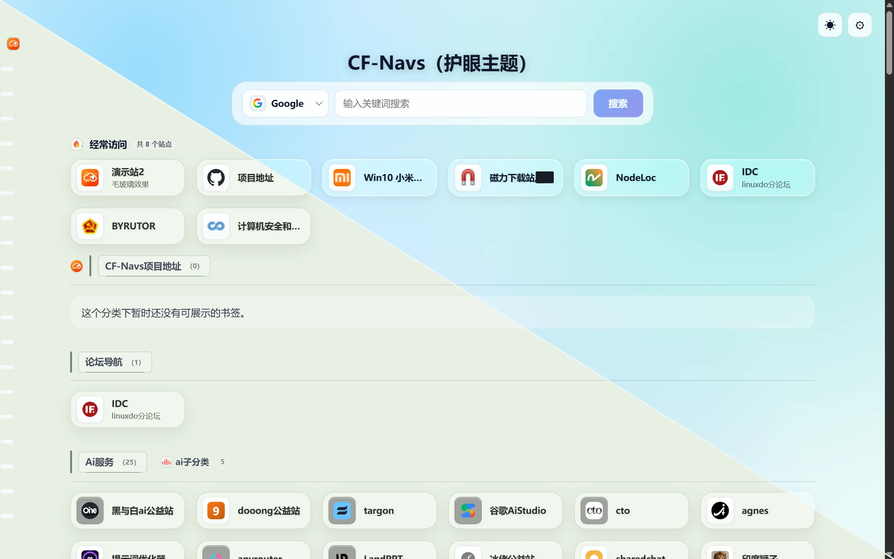
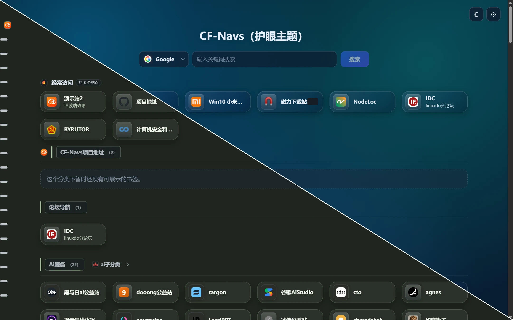
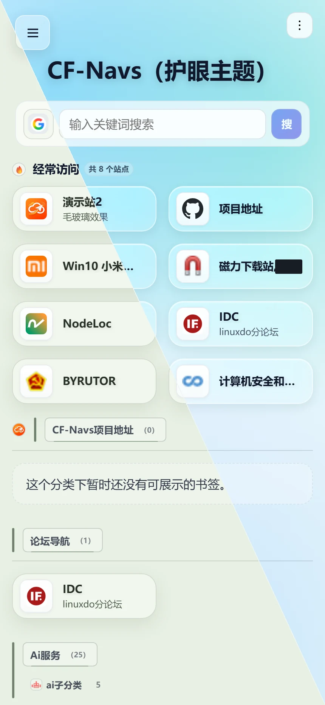
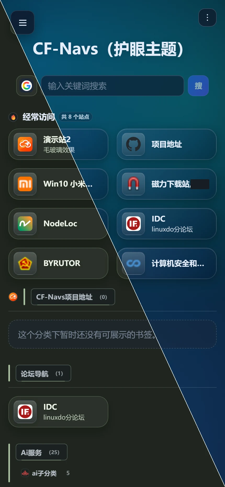
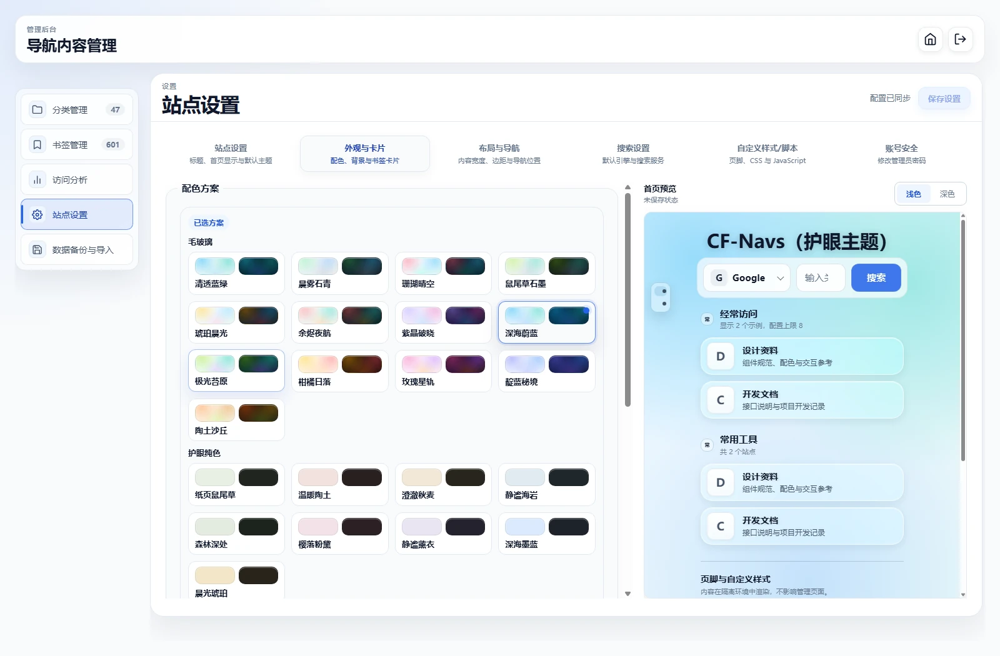
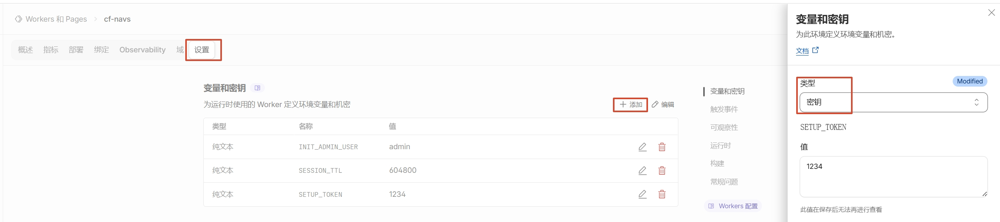

<div align="center">
  
  <h1>CF-Navs</h1>
  <p><strong>Bring your frequently used websites, work tools, and private favorites into your own start page.</strong></p>
  <p>Runs on Cloudflare Workers, no need to set up your own server. Import existing bookmarks, choose a theme, and open the same navigation space on your computer and phone.</p>

  <p>
    
    
    
    <a href="../../LICENSE"></a>
  </p>

  <p>
    <a href="#features">Features</a> ·
    <a href="#interface-preview">Interface Preview</a> ·
    <a href="#quick-deployment">Quick Deployment</a> ·
    <a href="#local-development">Local Development</a> ·
    <a href="../../docs/README.md">Project Documentation</a>
  </p>

  <a href="https://github.com/lbjxr/CF-Navs/fork">
    
  </a>
</div>

**Languages:** [简体中文](../../README.md)

---

## Features

**Save more, find faster, and organize with clarity.** CF-Navs combines two-level categorization, site-wide search, batch organization, and data backup. It's ideal as a personal start page, a work toolbox, or a public resource navigator. Visitors can browse public content, while administrators can manage all bookmarks after logging in—no need to maintain a separate site for private links.

| | Feature | Description |
|---|---|---|
| ☁️ | Edge Full-Stack Hosting | The entire site is hosted using Workers, D1, and KV. Your code and data remain under your own GitHub / Cloudflare account, eliminating the need to rent a VPS or maintain a database service. |
| 🧭 | Navigation Homepage | Primary groups and secondary categories are clearly presented. Supports searching by title, URL, description, and full category path. Navigation adapts to different screen sizes on the left, top, and mobile, with the top navigation capable of multi-line display. |
| 🏠 | Homepage Settings | The site title, search box, search engine selector, and number of "Frequent Visits" are all configurable, with real-time preview before saving. After logging in, you can directly create new primary and secondary categories on the homepage. |
| 🛠️ | Backend Management | Supports category editing, moving, reordering at the same level, and deletion protection. Paired with full path location and batch movement of bookmarks, it reduces the need for individual edits. Centralized management for the site, layout, search, backups, and account security. |
| 🔒 | Private Bookmarks | When adding or editing a bookmark, you can mark it as a "Private Link (visible only to logged-in users)." Regular visitors will not receive data for private bookmarks, while administrators can view and manage them normally after logging in. |
| 🗂️ | Private Categories | A category can be set to "Hidden from visitors (visible only to logged-in users)." Visitors will not see the category, its subcategories, or the bookmarks within them. Administrators can still manage them normally after logging in. |
| ↕️ | Cross-Category Reordering | Supports moving bookmarks between primary, secondary, and empty categories, as well as adjusting their order within a category. Use drag-and-drop on PC, or the "Move to Category" option on mobile. Save or cancel all changes at once. |
| 🔄 | Browser Bookmark Sync | One-way sync can be enabled in the backend. The Chrome/Edge extension will place any newly added bookmarks into the "Browser Additions" collection, without altering existing categories or deleting bookmarks on the navigation page. |
| 📊 | Access Analytics | Clicks on homepage bookmarks are tallied. The backend provides statistics on total clicks, visited vs. unvisited bookmarks, a Top 20 list of most visited bookmarks, and a paginated list of unvisited bookmarks. The latest data is refreshed when you enter the analytics page. |
| 🎨 | Appearance Customization | Includes 22 built-in themes, light/dark mode, background and accent color options. Font size and icon size for categories can be set separately for primary and secondary levels. Card size, transparency, and footer HTML / CSS / JavaScript are all customizable. CSS and footers support isolated previews. |
| 🔎 | Search & Icons | Offers site-wide group search, configurable external search engines, and support for displaying bookmark Favicons / Iconify icons, category images, text, and emoji icons. |
| 💾 | Data Migration | Export backups in full or by category, optionally including site settings. JSON files can be appended, merged, or overwritten for restoration. Compatible with Sun-Panel data and browser bookmark HTML. |
| 🔐 | Security & Authentication | Features PBKDF2 password hashing, Bearer Session Tokens, CSP, admin API authentication, and rate limiting for failed login attempts. Private icons have access authorization and cache isolation. |
| ⚡ | Loading Optimization | Includes code splitting, edge caching, local snapshots, lazy loading for icons, and basic PWA offline fallback. Direct backend refreshes won't cause a flash of the homepage first. |

Prefer a compact layout? The minimum width for desktop detail cards can be set to **40 px**, while mobile retains a safe minimum of **150 px**. Extremely narrow cards will compress titles and descriptions, making them better suited for icon-based navigation.

### Bookmark Privacy and Cross-Category Reordering

- **Direct Organization on the Homepage**: After logging in, you can create new primary categories or new subcategories under the current group. The view will automatically focus on the newly created item. When editing a bookmark, the category selector will expand and highlight the current category, reducing the need to search repeatedly.
- **Private Links**: Administrators can check the "Set as private link (visible only to logged-in users)" box when adding or editing a bookmark. The public data API for unauthenticated visitors will filter out such bookmarks. Administrators can still view, edit, and delete them on the homepage and in the backend after logging in.
- **Private Categories**: Administrators can check the "Hidden from visitors (visible only to logged-in users)" box when editing a category in the backend. Unauthenticated visitors will not receive data for this category, its subcategories, or the bookmarks within them. Administrators can still view and manage them normally after logging in. Existing categories remain visible to visitors by default.
- **Cross-Category Drag-and-Drop**: After logging in as an administrator, click "Reorder" on any category on the homepage to enter a unified reordering session. On PC, you can drag bookmarks into primary, secondary, or empty categories and adjust their positions. On mobile, you can select a target category via "Move to Category." Click "Save Reorder" at the bottom to save all category and order changes, or "Cancel" to discard the current session's modifications.
- **Batch Movement**: When a large number of bookmarks need to be reorganized, you can filter and select multiple bookmarks in the backend, choose a target category, confirm the full path, and complete the move in one go—no need to open individual edit forms.
- **Browser Bookmark Sync**: After enabling "Browser Bookmark Sync" under "Settings → Site Settings" in the backend, a "Browser Additions" category will be created automatically. Once you install and log in with the Chrome/Edge extension from [`browser-extension`](../../browser-extension/), any new web bookmarks added in your browser will be synced to this category. They will be saved with icon candidates following the default icon strategy (`https://favicon.im/<hostname>?larger=true`). The extension does not create navigation categories based on browser bookmark folders; it only performs a one-way addition from "Browser → Navigation Page" without deleting or overwriting existing bookmarks on the navigation page. You can then drag them to other categories directly in the homepage's reorder mode.

## Interface Preview

<table>
  <tr>
    <td align="center" width="50%">
      <strong>Light Home Page</strong><br>
      
    </td>
    <td align="center" width="50%">
      <strong>Dark Home Page</strong><br>
      
    </td>
  </tr>
  <tr>
    <td align="center" width="50%">
      <strong>Light Mode (Mobile)</strong><br>
      
    </td>
    <td align="center" width="50%">
      <strong>Dark Mode (Mobile)</strong><br>
      
    </td>
  </tr>
</table>

<p align="center">
  <strong>Theme and Site Settings</strong><br>
  
</p>

More interface screenshots can be found in [`docs/screenshots`](../../docs/screenshots).

## Quick Deployment

**Don't want to mess with servers? We recommend starting with a console deployment.** Prepare your GitHub and Cloudflare accounts, then complete the deployment by following "Fork → Associate Repository → Set Installation Token → Initialize via Web". A normal installation does not require manually executing SQL or entering a Cloudflare API Token. If Workers Builds / Git import is unavailable, you can use the [GitHub Actions Alternative Deployment](../../docs/guides/DEPLOYMENT.md#方式三github-actions备选); however, associating a Cloudflare account is still the recommended default method.

You can start with Cloudflare's free plan, but the free tier is not unlimited. Requests, databases, and KV operations each have quotas. For details, refer to the official documentation for [Workers](https://developers.cloudflare.com/workers/platform/pricing/), [D1](https://developers.cloudflare.com/d1/platform/pricing/), and [KV](https://developers.cloudflare.com/kv/platform/pricing/).

For your first use, please select a deployment method and complete the entire process. Do not mix the two procedures. Regardless of the method you use, the database and administrator account will ultimately be initialized via `/install`.

### Self-hosted (Docker)

You can also self-host without using Cloudflare: this repository also provides a Docker deployment for Node + SQLite (runtime is in `server/`, deployment assets are in `docker/`). The application features are identical to the Cloudflare version, and there is a ready-made import tool for migrating data from Cloudflare:

```bash
git clone https://github.com/lbjxr/CF-Navs.git
cd CF-Navs/docker
```

For deployment, reverse proxy, data migration, backup and recovery, and security boundaries, see
[DOCKER_DEPLOY.md](../../docs/guides/DOCKER_DEPLOY.md).

CF-Navs requires the following Cloudflare resources:

| Resource | Binding Name | Purpose |
|---|---|---|
| D1 Database | `DB` | Stores settings, categories, and bookmarks |
| KV Namespace | `SESSION` | Login rate limiting, click rate limiting, and session revocation list |
| Secret | `SETUP_TOKEN` | Manually configured to authorize the initial installation |

### Method 1: Cloudflare Console Deployment (Recommended)

This method is suitable for users who want to operate entirely in the browser and avoid installing local tools. After Cloudflare links to your GitHub fork, it will automatically build and deploy from the `main` production branch. When synchronizing upstream updates later, please also update this branch.

#### Step 1: Fork This Repository

[](https://github.com/lbjxr/CF-Navs/fork)

Click the **"Fork on GitHub"** button above and give it a ⭐ Star!

#### Step 2: Deploy to Cloudflare Workers

[](https://dash.cloudflare.com/?to=/:account/workers-and-pages)

Click the button above to go to Cloudflare, then choose to connect to GitHub. After granting authorization, select the project you just forked.


After clicking **Start Setup**, confirm the following values in the build configuration (keep other settings at their defaults):

- Build Command: `npm run build`
- Deploy Command: `npx wrangler deploy`
- The production branch `main`, root directory `/`, and Node.js environment are automatically detected by [`wrangler.toml`](../../wrangler.toml). If you need to specify a Node.js version, set `NODE_VERSION=24` in **Build Variables** ([official documentation](https://developers.cloudflare.com/workers/ci-cd/builds/build-image/)).


#### Step 3: Save and Complete the First Production Deployment

Save and complete the first **Production** deployment. Under normal circumstances, Cloudflare will create and bind the `DB` D1 database and the `SESSION` KV namespace based on [`wrangler.toml`](../../wrangler.toml).

You should see these two bindings after the first deployment. If you encounter a "missing binding" error or a resource creation permission error, first confirm that the deployment is coming from the `main` **Production** environment and that the correct Cloudflare account is selected. Then, refer to [Troubleshooting](../../docs/guides/TROUBLESHOOTING.md). Do not repeatedly create databases or KV namespaces without confirming the account and resources.

#### Step 4: Configure the SETUP_TOKEN Secret

After the first production deployment is complete, go to **Settings → Variables & Secrets** for the Worker, select the **Production** environment, and configure `SETUP_TOKEN`:

- If a `SETUP_TOKEN` automatically generated by Cloudflare already exists in the list, edit it and replace its value with one you save yourself. Then, go to **Settings → Build** and perform a **Clear Cache**.
- If the existing entry is a plain text variable instead of a secret, delete it and re-add a `SETUP_TOKEN` of the **Secret** type. Do not keep a plain text variable and a secret with the same name at the same time.
- If `SETUP_TOKEN` is not in the list, manually add a variable of the **Secret** type. Use a sufficiently long random string for the value; do not add it as a plain text variable.



#### Step 5: Redeploy to Apply the Secret

After saving the secret, redeploy the same `main` production deployment. You can either **Retry/Redeploy** the most recent production deployment on the **Deployments** page, or push a new commit to the `main` branch. Do not access `/install` immediately after saving the secret; you must first let the new deployment read the secret.

#### Step 6: Access `/install` to Complete Installation

Open the deployed Workers URL and navigate to `/install`. Enter the `SETUP_TOKEN` value configured in your current production environment, then create an administrator username and password. After confirming that the installation and login are successful, delete or rotate this token. Regardless of whether it was originally generated by Cloudflare or added by you, it is no longer needed for a successfully installed site.

A custom domain is optional: first add and enable a custom domain under **Domains & Routes**, confirm that it works correctly and that you can log in, then disable the `workers.dev` address as needed. If you are not ready for a custom domain, keep the Workers URL and do not disable the default access point prematurely.

### Method 2: Wrangler CLI Deployment

Prerequisites: Node.js **22.12+ (22.x) or 24+**, npm, and a Cloudflare account. Node.js 24 LTS is recommended. All resource commands will act on the account currently logged in to Wrangler. If you have multiple Cloudflare accounts, first confirm your account with `npx wrangler whoami`.

```bash
git clone https://github.com/lbjxr/CF-Navs.git
cd CF-Navs
git switch develop
npm install

npx wrangler login
npx wrangler whoami

# Run the following two create commands only once, if the resources do not already exist
npx wrangler d1 create cf-navs-db
npx wrangler kv namespace create SESSION

npm run setup:wrangler
npm run deploy                 # Initial deployment to create the Worker first
npx wrangler secret put SETUP_TOKEN
npm run deploy                 # Redeploy after the secret takes effect
```

If the D1 database or KV namespace already exists, do not run the `create` commands again. First, use `npx wrangler d1 list` and `npx wrangler kv namespace list` to confirm the resources in your current account, then run `npm run setup:wrangler`. The D1 database name should be `cf-navs-db`, and the Worker's KV binding name should be `SESSION`.

`npm run setup:wrangler` will write the actual resource IDs to `wrangler.local.toml`, which is ignored by Git. After deployment is complete, access `/install` to have the installer initialize the database structure and create the administrator. Do not run `wrangler secret put` before the first deployment is complete, as the Worker has not yet been created.

A normal installation does not require manual SQL execution. Only if the installer reports a schema initialization failure should you use [`schema.sql`](../../schema.sql) or `npm run db:init:remote` to recover.

### Post-Deployment Checks Common to Both Methods

- `/install` can be opened and used to complete initialization with the `SETUP_TOKEN`.
- You can log in to the admin panel with the newly created administrator account.
- Categories and bookmarks can be saved normally; data persists after refreshing the page.
- If the page still shows an old version, force-refresh to let the new Service Worker take over.
- If installation or binding fails, check the Worker logs with `npx wrangler tail`. Before running any commands involving live data, confirm your current Cloudflare account and the target Worker.

**Get your navigation page up and running now**: Import an existing set of bookmarks in the admin panel, choose a theme, set categories or links to hide, and then set the site as your browser's homepage. Afterwards, you can use a browser extension to collect new bookmarks and continuously organize them through sorting on the homepage or bulk moving in the admin panel.

For more configuration and troubleshooting, please read the following documents. Follow the requirements for the deployment branch and Node.js version on this page:

- [Quick Start](../../docs/guides/QUICKSTART.md)
- [Complete Deployment Guide](../../docs/guides/DEPLOYMENT.md)
- [Common Issues and Troubleshooting](../../docs/guides/TROUBLESHOOTING.md)

## Local Development

The development environment requires Node.js 22.12+ (22.x) or 24+. It is recommended to use Node.js 24 LTS, which is consistent with the CI environment.

Install dependencies:

```bash
npm install
```

Start the Worker and front-end development services separately:

```bash
# Terminal 1
npm run dev

# Terminal 2
npm run dev:web
```

The default front-end address is `http://localhost:5173`.

Common checks:

```bash
npm run type-check
npm test
npm run build
git diff --check
```

## Technology Stack

| Tier | Technology |
|---|---|
| Frontend | Svelte 5, TypeScript, Vite 7 |
| Worker API | Hono, Cloudflare Workers |
| Data & Session | Cloudflare D1, Cloudflare KV |
| Interaction & Sorting | SortableJS |
| Testing | Vitest 4, Svelte Check, real Chrome regression scripts |

## Project Structure

```text
CF-Navs/
├── src/                 # Svelte pages, components, and browser-side logic
├── worker/              # Worker routing, middleware, and D1 data access
├── shared/              # Shared types and contract settings for both frontend and backend
├── public/              # Icons, PWA assets, and other static resources
├── browser-extension/   # Browser extension for syncing bookmarks to Chrome/Edge
├── tests/               # Vitest unit and regression tests
├── docs/                # User guide, technical reference, and screenshots
├── scripts/             # Development, deployment, and audit scripts
├── schema.sql           # D1 database structure
└── wrangler.toml        # Cloudflare Worker public configuration
```

The architecture, API, and performance contracts can be found in the [project documentation index](../../docs/README.md).

## Environment Configuration

| Name | Type | Required | Description |
|---|---|---|---|
| `DB` | D1 binding | Yes | Database binding |
| `SESSION` | KV binding | Yes | Stores login/click rate limits and session revocation lists |
| `SETUP_TOKEN` | Secret | First-time installation | Authorizes `/install`; it is recommended to delete or rotate it after a successful installation |
| `SESSION_TTL` | Variable | No | Session validity period. The default in `wrangler.toml` is `2592000` seconds (30 days); if not set, the Worker will fall back to 7 days |
| `INIT_ADMIN_USER` | Variable | No | Used only for upgrading old databases or recovering credentials |
| `INIT_ADMIN_PASSWORD` | Secret | No | Used only for upgrading old databases or recovering credentials |
| `RESET_ADMIN_CREDENTIALS` | Variable | No | A one-time flag used when forcibly resetting credentials for an old database |

Do not commit real resource IDs, passwords, Tokens, or other Secrets to the repository.

## Data Import

Existing favorites do not need to be re-entered. The backend supports the following data formats:

- **CF-Navs JSON Backup**: Supports exporting all data or by category, preserving two-level category relationships. You can also choose whether to include site settings. During import, you can choose to append and merge by full path or restore by overwriting.
- **Sun-Panel Data**: Imports categories at the first level and converts bookmark and compatible icon fields. Migrating existing navigation doesn't require starting from scratch.
- **Browser Bookmark HTML**: Imports standard files exported from browsers. Valid folders are mapped to two-level categories, and deeper paths are flattened into second-level headings.

**Migrate only the parts you need**: You can export a main category and its subcategories, or select only second-level categories. The system will fill in the necessary parent category records without including bookmarks from unselected categories. This is ideal for moving a set of work resources to another CF-Navs instance or for creating a separate backup for key categories.

Please back up your existing data before importing: **Append mode retains duplicate links, while overwrite mode replaces all categories and bookmarks**. Partial export is a backup and migration feature, not an automatic deduplication or two-way synchronization tool. Backups may contain private links and site settings; please store them securely.

See [Sun-Panel Data Import](../../docs/guides/SUNPANEL_IMPORT.md) and [Browser Bookmark Import](../../docs/guides/BROWSER_BOOKMARK_IMPORT.md).

## Contributing

We welcome you to provide feedback on your experience via Issues and contribute improvements via Pull Requests. Before you begin, please read [Contributing](../../CONTRIBUTING.md) and complete verification based on the scope of your changes. For security issues, please use the [private reporting channel](../../SECURITY.md) and do not paste credentials or private bookmarks in public Issues.

## Acknowledgments

The project draws on the design concepts of [Sun-Panel](https://github.com/hslr-s/sun_panel), and some of its icon acquisition logic was inspired by [iori-nav](https://github.com/jy02739244/iori-nav).

## Star History

<a href="https://www.star-history.com/?repos=lbjxr%2FCF-Navs&type=date&legend=top-left">
 <picture>
   <source media="(prefers-color-scheme: dark)" srcset="https://api.star-history.com/chart?repos=lbjxr/CF-Navs&type=date&theme=dark&legend=top-left&sealed_token=7kyATdN3x5tJ6WJAhA5MwxWL93j-C9ZnSxJli_vTqztkkZF54Sp95nJzSMW-Xggc19KoraDrqDNjCWN6VuQrSEmOX8CAbyYqMi0I_6K3DS2GEr0x1rgf8VDa2kBJIgOP74JqDldlCFRRbGGNjvrDVJ12e4SIShmH78leu6Vxg6WQzidKg4PULPCzlwi-" />
   <source media="(prefers-color-scheme: light)" srcset="https://api.star-history.com/chart?repos=lbjxr/CF-Navs&type=date&legend=top-left&sealed_token=7kyATdN3x5tJ6WJAhA5MwxWL93j-C9ZnSxJli_vTqztkkZF54Sp95nJzSMW-Xggc19KoraDrqDNjCWN6VuQrSEmOX8CAbyYqMi0I_6K3DS2GEr0x1rgf8VDa2kBJIgOP74JqDldlCFRRbGGNjvrDVJ12e4SIShmH78leu6Vxg6WQzidKg4PULPCzlwi-" />
   
 </picture>
</a>

## License

This project is licensed under the [Apache License 2.0](../../LICENSE). For project attribution information, see [`NOTICE`](../../NOTICE).

### Forking and Attribution Guidelines

If you fork, redistribute, or publish modified versions based on CF-Navs, please:

- Retain the `LICENSE`, `NOTICE`, and any existing copyright, license, and attribution statements in the source files.
- As required by the Apache License 2.0, include clear notes of your changes in the modified files.
- Clearly state in the README or product documentation that the project is based on CF-Navs and provide a link to the upstream repository. Do not imply that the modified version is officially released or endorsed by the original project authors.

The above guidelines are intended to help users identify derivative versions. The specific licensing rights and obligations are governed by [LICENSE](../../LICENSE).

<!-- Afdian Sponsorship Section (Collapsible Card) -->
<hr>

<div align="center">

<details>
  <summary><b>☕️ Like CF-Navs? Buy the author a coffee / Sponsor</b></summary>
  <br>
  <p>If this project has been helpful to you, feel free to show your support through sponsorship! Your support is the greatest motivation for keeping the project updated and maintained ❤️</p>
  <a href="https://afdian.com/a/benjian" target="_blank">
    
  </a>
  <p><small>💡 Sponsorship includes assistance with setup. For details, please see the Afdian homepage.</small></p>
</details>

</div>
